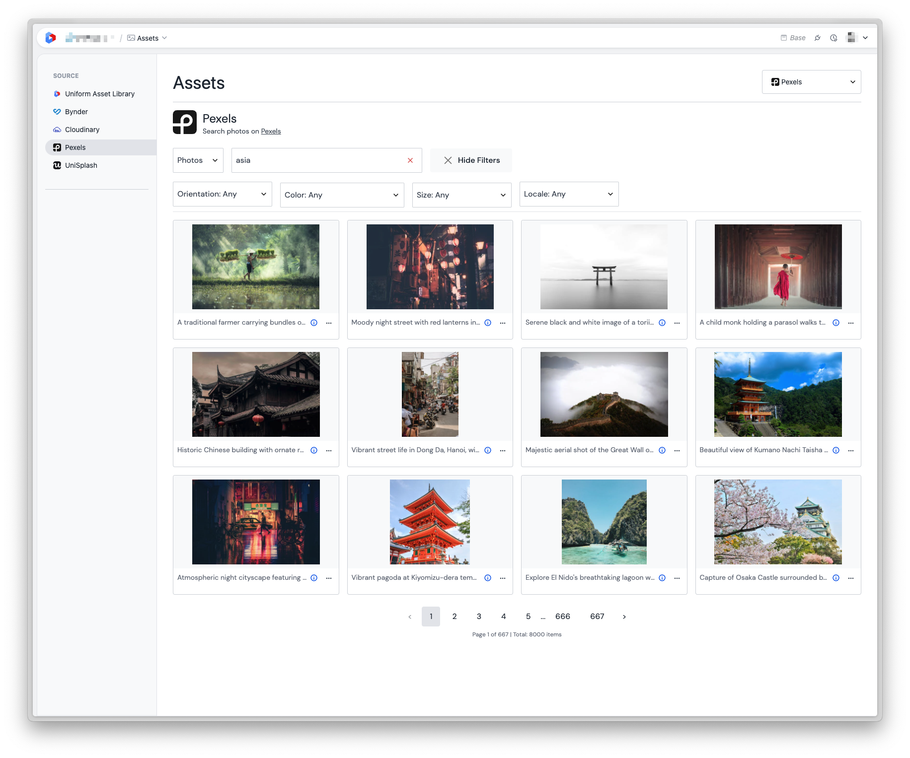
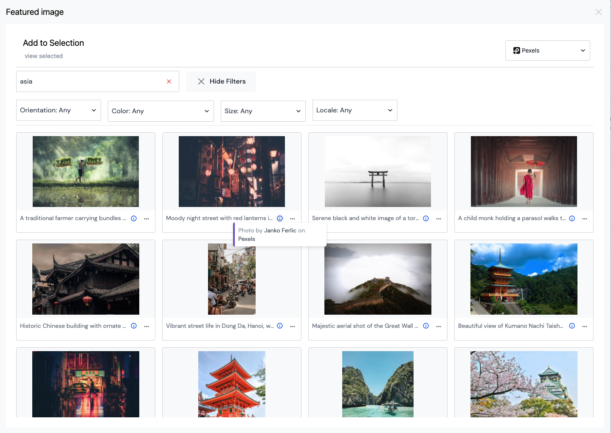

# Uniform Pexels Integration

This is an example integration to extend the [Uniform asset library](https://docs.uniform.app/docs/guides/composition/manage-assets) with [Pexels](https://www.pexels.com) images and videos.

⚠️ **Note:** This is an unofficial community integration, not supported by [Uniform](https://uniform.dev) or [Pexels](https://www.pexels.com). It serves as an example for extending Uniform's asset library with third-party providers like [Pexels](https://www.pexels.com). The codebase was primarily AI-generated using [Cursor](https://www.cursor.com/), with manual review and editing.

## Core Features

- Browse featured photos and popular videos from Pexels
- Search photos and videos, with filters for orientation, size and locale (and color for photos)
- Pick Pexels photos and videos in asset parameters, including parameters that allow several assets
- Preserve Pexels metadata and attribution in the asset record
- Download photos and videos in the sizes Pexels offers
- Add a chosen photo size or video file to the Uniform asset library, keeping the Pexels attribution
- View photographer and videographer credits

Both locations can download a resolution or, when turned on in the settings, add it to the Uniform asset library ("Add to Uniform Asset Library" in an item's menu). Importing copies the file into Uniform, so it is served from Uniform's CDN rather than hotlinked from Pexels. In an asset parameter, the imported Uniform asset is then selected in the parameter. Picking an item without importing it still stores the Pexels-hosted asset, as before.

Importing the same item at the same resolution again reuses the existing asset. Files larger than 50 MB (the Uniform asset library limit) can't be imported; pick a smaller resolution.

### Screenshots

Asset library:



Asset parameter (in a Uniform project):



### ⚠️ Note: Asset hotlinking

This integration is currently hotlinking photos and videos from Pexels. This is not the recommended way to use Pexels media and is subject to change.

## Basic Usage

1. Sign up for a Pexels account and get an API key on their [developer portal](https://www.pexels.com/api/)
2. [Add](#add-a-custom-integration-to-your-uniform-team) a custom integration to your Uniform team
3. [Install](#install-the-integration-to-your-uniform-project) the integration to your Uniform project

## Installation

### Add a custom integration to your Uniform team

First create a custom integration in your Uniform team:

Via the Uniform dashboard:
1. In your Uniform team, go to Settings > Custom Integrations
2. Click "Add Integration"
3. Paste the contents of a manifest into the Mesh app manifest:
   - `mesh-manifest-production.json` for the deployed app (integration type `pexels`)
   - `mesh-manifest-local.json` for local development against `http://localhost:9000` (integration type `pexels-dev`)
4. Click "Save"

Alternatively, you can use the Uniform CLI to register the production manifest (Team Admin API key required):

```bash
npm run register-to-team
```

### Install the integration to your Uniform project

The integration then can be installed as a custom integration in the projects of the Uniform team:

1. In your Uniform project, go to Settings > Integrations
2. Find the "Pexels" integration in the list and click on it
3. Follow the prompts to install the integration
4. Enter your Pexels API key and other [configuration options](#configuration-options)

Alternatively, you can use the Uniform CLI to install the integration (Team Admin API key required):

```bash
npm run install-to-project
```


## Configuration Options

- **API Key**: Your [Pexels API key](https://www.pexels.com/api/) (required). It is checked against Pexels when you save. The key is sent from the editor's browser, so anyone who can use the integration can see it.
- **Assets Per Page**: Number of assets to display per page, from 1 to 80 (default: 12)
- **Add Author Credits**: Whether to add the credit, e.g. "Photo by John Doe on Pexels", to asset descriptions (default: on). The credit is always stored in `custom.attribution`.
- **Allow adding Pexels assets to the Uniform asset library**: Shows the "Add to Uniform Asset Library" action (default: off). Turn it on only where the deployment is [set up for identity delegation](#adding-assets-to-the-uniform-asset-library); the settings page warns when it isn't.

## Stored Asset Data

A picked photo is stored as a Uniform asset with:

- `url`: the original photo file, with `width` and `height` describing that file. The Pexels CDN resizes on request, so frontends should append size parameters instead of loading the original, for example `?auto=compress&w=800`.
- `id` and a stable `_id` (`pexels-image-<id>`), so picking the same photo again gives the same value
- `title`: the Pexels alt text (Uniform assets have no separate alt field), or "Photo by ..." when there is none
- `description`: the alt text, plus the credit when author credits are on
- `mediaType`: e.g. `image/jpeg`
- `custom`: Pexels metadata, including `attribution`, `photographer`, `photographerUrl`, `pexelsUrl`, `avgColor` (useful as a placeholder color), `alt`, and URLs of the fixed Pexels renditions (`photoLargeUrl`, `photoMediumUrl`, ...)

A picked video stores its best quality file (the widest HD file) as `url`, with that file's dimensions and `mediaType`, and `custom` metadata such as `attribution`, `authorName`, `videoThumbnailUrl` and `duration`.

Assets picked with versions before this change used a random `_id`, and their `url` pointed to the ~940px "large" rendition while `width` and `height` described the original photo.

## Adding assets to the Uniform asset library

Imports run as the signed-in author through [identity delegation](https://docs.uniform.app/docs/integrations/mesh-integrations/identity-delegation). Authors need permission to create assets in the project. No Uniform API key is stored or shared.

1. The location asks the dashboard for a one-time session token (`sdk.getSessionToken()`). Authors may be asked for consent the first time.
2. `POST /api/delegation/session` exchanges it with the integration secret and stores the delegated token in an encrypted, HttpOnly cookie.
3. `POST /api/import` looks the item up on Pexels again, uploads the chosen file to Uniform and creates the asset, using the author's delegated token.

Setup:

1. Turn on **Allow adding Pexels assets to the Uniform asset library** in the integration settings of each project that should have it. With it off, the integration never asks for a session token.
2. Register or update the integration with its manifest. Both manifests set `"identityDelegation": true`.
3. In Settings → Custom Integrations, open the integration's Credentials tab and choose **Generate secret**. Copy the integration ID and app secret; they are only shown once.
4. Set `UNIFORM_INTEGRATION_ID`, `UNIFORM_INTEGRATION_SECRET` and `MESH_SESSION_SECRET` on the server (see `.env.example`). The integration secret must never reach the browser.
5. Serve the integration over HTTPS, including locally (`npm run dev` uses `--experimental-https`).

If the setting is on but delegation is unavailable (the manifest lacks `identityDelegation`, or the deployment lacks the credentials, in which case the API routes answer `503 not_configured`), browsing, picking and downloading still work, and the import action is disabled with an explanation.

Imported assets only support Uniform's writable asset fields (title, description, file). The title is the Pexels alt text, and the description holds the credit, the photographer or videographer's profile, the Pexels page, the resolution and the import date.

## Media Support

This integration supports both photos and videos from the Pexels API. For detailed information about available formats, sizes, and options, please refer to the official Pexels API documentation:

- [Pexels API Documentation](https://www.pexels.com/api/documentation/)
- [Photos Search Documentation](https://www.pexels.com/api/documentation/#photos-search)
- [Videos Search Documentation](https://www.pexels.com/api/documentation/#videos-search)

## Development

1. Clone the repository and use Node 24 (`nvm use`)
2. Create a `.env` file based on `.env.example`
3. Run `npm install` to install the dependencies
4. Run `npm run dev` to start the development server on https://localhost:9000 (HTTPS is required for identity delegation; accept the local certificate once)
5. Register `mesh-manifest-local.json` in your team and install the "Pexels (Development)" integration in a project

Checks (also run in CI):

```bash
npm run lint
npm run typecheck
npm test
npm run build
```

## Deployment

The integration can be deployed to any provider that supports Next.js API routes, such as Vercel or Netlify. Set the identity delegation environment variables from `.env.example`.

The import route's time limit comes from your hosting platform's function settings (on Vercel, Project Settings → Functions → Max Duration). Large videos can take a while, so give it as much time as your plan allows and set `IMPORT_MAX_DURATION` to the same number of seconds (default 60). The import then stops waiting in time to tell the author to try again, and a retry reuses the uploaded file once Uniform has finished processing it.

If you create your own deployment make sure to update the `mesh-manifest-production.json` file with the correct base URL. And copy the contents of the manifest into your custom integration.

## Architecture

The integration is built with:

- Next.js (Page Router) for the location pages
- Uniform Mesh SDK and design system for the locations and UI
- A small typed client for the Pexels API (`lib/pexels/client.ts`), called from the browser and from the import route
- Next.js API routes (`pages/api/`) as the backend for identity delegation and imports
- Vitest for unit tests
- Tailwind CSS for layout

The location pages in `pages/` are thin adapters around `useMeshLocation`. The logic lives in `lib/`: the Pexels client and request routing (`lib/pexels/`), the mapping from Pexels to Uniform assets (`lib/mapping.ts`), selection handling (`lib/selection.ts`) and the hooks that hold the library state (`lib/hooks/`). Server-only code lives in `lib/server/`: the delegation session (`delegation.ts`) and the import itself (`importAsset.ts`).

## Attribution

The [Pexels API guidelines](https://www.pexels.com/api/documentation/) ask for a prominent link to Pexels wherever API results are shown, and for photographers to be credited whenever possible, e.g. "Photo by John Doe on Pexels" with a link to Pexels. The integration links to Pexels in the asset library and parameter views and shows credits on every item. Each picked asset stores its credit in `custom.attribution`, and, unless turned off in the settings, in its description. Imported assets always carry the credit and links to Pexels in their description, whatever the setting says, because they no longer link back to Pexels otherwise. Your frontend is responsible for displaying it.

## License

See the LICENSE file for details.

